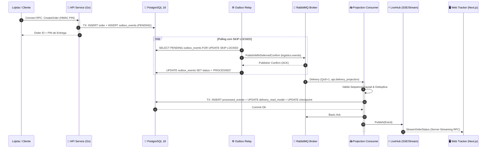
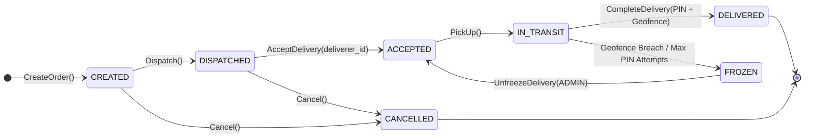

<div align="center">
  
</div>

# Motor Logístico: Despacho Assíncrono para o Comércio Local


-336791?style=for-the-badge&logo=postgresql)

-FF6600?style=for-the-badge&logo=rabbitmq)


## Visão Geral
Plataforma inteligente de gestão logística, despacho assíncrono e rastreamento em tempo real projetada para conectar diretamente pequenos comércios de bairro a entregadores parceiros da região.

O sistema elimina taxas abusivas de marketplaces centralizados, viabilizando um **Motor de Despacho (Fan-out) de alta performance e resiliência bancária (Zero Trust)**. A plataforma garante resolução atômica de concorrência, consistência eventual estrita via Transactional Outbox com Publisher Confirms, roteamento físico geodésico (OSRM), tolerância a partições com Gap Recovery e observabilidade de ponta a ponta.

---

## 🏛️ Arquitetura e Estrutura do Monorepo

O projeto adota uma arquitetura em **Monorepo** com separação clara de responsabilidades entre backend, frontend, simulador autônomo, suíte de testes de carga e infraestrutura:

```text
├── api/          # Backend Go (Connect RPC, Domain Services, Transactional Outbox, OTel, LiveHub)
├── web/          # Frontend Next.js 16 / React 19 (Dashboard do Lojista, Mapa MapLibre GL, Auth)
├── simulator/    # Motor autônomo em Go para simulação de entregadores e replay de rotas OSRM
├── loadtest/     # Suíte de testes de carga k6 e monitoramento de saturação com Circuit Breaker
├── proto/        # Definições contratuais gRPC / Connect RPC via Protocol Buffers
├── migrations/   # Migrações versionadas do PostgreSQL/PostGIS (000001 a 000008)
├── infra/        # Configurações de observabilidade e mensageria (Prometheus, OTel, Tempo, Loki, Grafana, RabbitMQ)
└── docs/         # Decisões de Arquitetura (ADRs 001 a 019), C4 Model, Contratos e Runbooks
```

### Documentação Técnica e Arquitetural
- [Desenho da Arquitetura (C4 Model) e Bounded Contexts](docs/architecture.md)
- [Contratos de API (Protobuf & Connect RPC)](docs/api-contracts.md)
- [Esquema de Banco de Dados e Dicionário de Dados](docs/database-schema.md)
- [Arquitetura de Decisões (ADRs 001 a 019)](docs/adrs/)
  - [ADR-002: Transactional Outbox Pattern](docs/adrs/002-transactional-outbox.md)
  - [ADR-013: Observabilidade OTel, Tempo e Prometheus](docs/adrs/013-observabilidade-otel.md)
  - [ADR-018: Autenticação Zero Trust, JWT e Gestão de Sessões](docs/adrs/018-autenticacao-gestao-sessoes.md)
  - [ADR-019: Topologia RabbitMQ Declarativa e Pacing da Telemetria](docs/adrs/019-topologia-rabbitmq-declarativa-e-pacing-telemetria.md)
- [Regras de Negócio e Ciclo de Vida do Pedido](docs/business-rules.md)
- [Estratégia de QA, Concorrência e Testes](docs/testing.md)
- [Runbooks Operacionais (DLQ, Redis, Rollback)](docs/runbooks/)

---

## 🔄 Fluxo de Dados e Ciclo de Vida dos Eventos

O ciclo de vida dos pedidos e da telemetria segue uma rigorosa separação em 4 estágios determinísticos:



---

## 🧩 Modelagem de Dados e Regras de Negócio

### Ciclo de Vida do Pedido (State Machine)
As transições de estado são blindadas no nível de domínio e com constraints no banco relacional:



### Regras Físicas e Segurança (Zero Trust)
1. **Conclusão de Entrega Segura (RF05/RNF09):** O encerramento da corrida exige conferência do **PIN de 4 dígitos** (hasheado via HMAC-SHA256 dual-key) e validação geodésica (**Geofencing** de até 50m do endereço de entrega, com zona de tolerância e auditoria até 300m).
2. **Idempotência Estrita por Impressão Digital (ADR-019):** Eventos de telemetria e projeção geram hash SHA-256 canônico resistente a jitter sub-5cm. Mensagens idênticas recebem ACK sem duplicar escritas; divergências de payload ou concorrência causal disparam rejeição para Dead Letter Queue (`logistics.events.dlx`).
3. **Outbox Relay com Publisher Confirms Diferidos:** O relay do outbox aguarda confirmação explícita do broker antes de marcar eventos como `PROCESSED`, prevenindo perda de dados em quedas abruptas de conexão AMQP.

---

## 📊 Observabilidade e Telemetria

A infraestrutura conta com observabilidade unificada através do **OpenTelemetry Collector Contrib**:

- **Métricas:** Prometheus (`:9090`) coletando dados da API (`:8080/metrics`), do RabbitMQ Management (`:15692`) e do pool do PostgreSQL.
- **Traces Distribuídos:** Grafana Tempo (`:3200`) recebendo spans gRPC/HTTP OTLP (`:4317`) propagados via W3C Trace Context (`traceparent`).
- **Logs Estruturados:** Grafana Loki (`:3100`) correlacionado a traces via `trace_id`.
- **Dashboards Prontos no Grafana:**
  - `App Overview`: RPS, latências de endpoints Connect RPC, taxa de erros HTTP/gRPC.
  - `PostgreSQL Pool`: Conexões abertas, esperas de locks, uso de transações.
  - `RabbitMQ Events & Outbox`: Taxas de publish, filas ativas, tempos de confirmação e volume de DLQ.
  - `Logs & Traces`: Navegação cruzada Trace-to-Logs e Trace-to-Metrics.

---

## 🛠️ Stack Tecnológica

| Componente | Tecnologia | Versão | Função Principal |
|---|---|---|---|
| **Backend API** | Go | `1.22+` | Monolito Modular, RPCs Connect, Interceptores, Worker Outbox |
| **Frontend** | Next.js / React | `16 / 19` | Portal do Lojista, Mapa MapLibre GL, Streaming em Tempo Real |
| **Simulador** | Go / OSRM | `1.22+` | Replay de rotas físicas de motocicletas, pacing e telemetria |
| **Banco de Dados** | PostgreSQL + PostGIS | `18` | Persistência transacional, Read Model e cálculos espaciais |
| **Cache & Geo** | Redis | `8 Alpine` | Cache rápido e estruturas espaciais para busca de entregadores |
| **Broker de Eventos** | RabbitMQ | `4.3.5` | Mensageria, Quorum Queues, Dead Letter Exchanges |
| **Coletor OTel** | OTel Collector Contrib | `0.100.0` | Ingestão e pipeline de traces, métricas e logs |
| **Rastreamento** | Grafana Tempo | `2.4.0` | Armazenamento de traces distribuídos |
| **Logs** | Grafana Loki | `3.7.7` | Ingestão de logs centralizados |
| **Métricas** | Prometheus | `v3.13.2` | Coleta de métricas e alertas automáticos |
| **Visualização** | Grafana | `13.2.1` | Painéis e auditoria operacional unificada |

---

## 🚀 Como Executar o Projeto

### Pré-requisitos
- [Docker](https://docs.docker.com/get-docker/) e [Docker Compose](https://docs.docker.com/compose/)
- [Go 1.22+](https://go.dev/dl/)
- [Node.js 20+](https://nodejs.org/) e npm
- [Buf CLI](https://buf.build/docs/installation)
- [golang-migrate](https://github.com/golang-migrate/migrate)

### 1. Configurar Variáveis de Ambiente
Copie o arquivo de exemplo e configure suas chaves de segurança:
```bash
cp .env.example .env
```
> **Nota de Segurança:** As variáveis `JWT_SECRET`, `PIN_HMAC_SECRET` e `GRAFANA_ADMIN_PASSWORD` devem ser strings seguras com comprimento mínimo de 32 bytes (256 bits).

### 2. Inicializar a Infraestrutura
Inicie todos os containers de infraestrutura em segundo plano:
```bash
make up
```

### 3. Aplicar as Migrações do Banco
Aplique as 8 migrações estruturais do PostgreSQL:
```bash
make migrate-up
```

### 4. Executar os Serviços Localmente

#### Opção A: Executar via Docker Compose Completo
O `docker-compose.yml` inclui a API e o Simulador conteinerizados. Para subir tudo de uma vez:
```bash
docker-compose up -d --build
```

#### Opção B: Desenvolvimento Local (Hot Reload / Debug)
- **Executar a API (Go):**
  ```bash
  cd api
  go run cmd/server/main.go
  ```
- **Executar o Frontend (Next.js):**
  ```bash
  cd web
  npm install
  npm run dev
  ```
  O portal web estará acessível em `http://localhost:3001` e a API em `http://localhost:8080`.

- **Executar o Simulador de Entregas (Go):**
  ```bash
  cd simulator
  go run main.go
  ```

---

## 🧪 Comandos Úteis (Makefile & Scripts)

| Comando | Descrição |
|---|---|
| `make up` | Sobe todos os containers da infraestrutura via Docker Compose |
| `make down` | Encerra os containers e redes locais |
| `make logs` | Visualiza logs unificados dos containers |
| `make migrate-up` | Executa todas as migrações SQL pendentes (`migrations/`) |
| `make migrate-down` | Reverte a última migração aplicada |
| `make proto-gen` | Gera o código Go e TypeScript via Buf CLI (`proto/`) |
| `make lint` | Executa `golangci-lint` na API e `eslint` no frontend Web |

### Testes de Carga e Saturação (k6)
O diretório `loadtest/` contém scripts para validação de resiliência e saturação sob alto volume:
- `k6 run loadtest/create_order.js`: Teste de carga de criação contínua de pedidos com ramping de VUs.
- `k6 run loadtest/gate14c_1000_orders.js`: Teste de saturação de 1.000 pedidos concorrentes.
- `python3 loadtest/monitor_telemetry.py`: Monitor em tempo real de filas, conexões e Circuit Breaker.
- `./loadtest/verify_consumer_idempotency_redelivery.sh`: Teste automatizado de redelivery e deduplicação.

---

## 🔐 Portas e Endpoints Padrão

| Serviço | Porta Local | Protocolo / Descrição |
|---|---|---|
| **API Backend** | `8080` | Connect RPC / HTTP REST (`/metrics`, `/health`) |
| **Web Portal** | `3001` | Dashboard Next.js / Mapa de Acompanhamento |
| **PostgreSQL** | `5432` | Banco relacional com extensão PostGIS |
| **Redis** | `6379` | Cache e índices geoespaciais |
| **RabbitMQ AMQP** | `5672` | Protocolo de mensageria AMQP 0-9-1 |
| **RabbitMQ UI** | `15672` | Painel de Gestão RabbitMQ |
| **RabbitMQ Metrics** | `15692` | Endpoint Prometheus do RabbitMQ |
| **Prometheus** | `9090` | Servidor de métricas e alertas |
| **Grafana** | `3000` | Dashboards de telemetria unificada |
| **Tempo (HTTP)** | `3200` | API e interface do Grafana Tempo |
| **Loki (HTTP)** | `3100` | Ingestão e consulta de logs estruturados |
| **OTel Collector** | `4317 / 4318` | Ingestão OTLP gRPC e HTTP |
